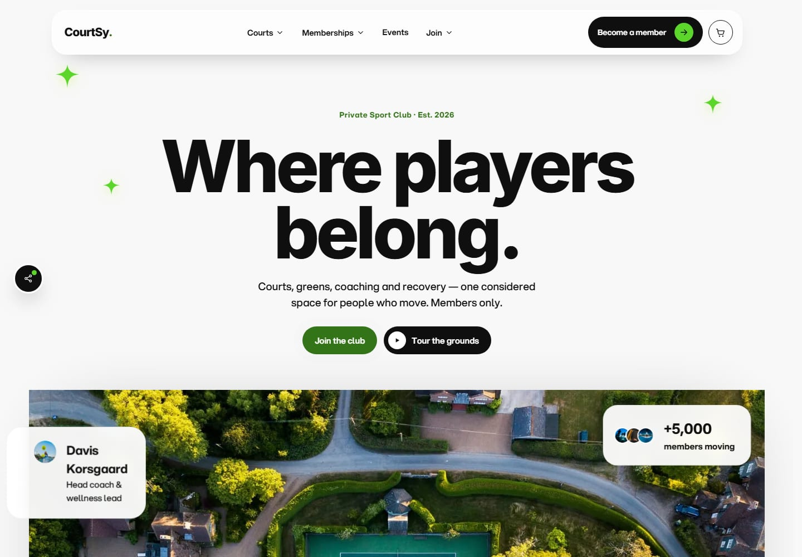

# CourtSy (ModernityRay)

Semestrální práce pro předmět **KTWA2**.

## O projektu

CourtSy je webová prezentace a objednávkový systém fiktivního soukromého
sportovního klubu. Klub nabízí tenisové kurty, golfové hřiště, posilovnu
s regeneračním centrem a krytý bazén.

Návštěvník si na webu může:

* porovnat pět úrovní členství od jednodenní vstupenky po firemní tarif
  a prohlédnout si detail každé z nich,
* projít areály klubu a rezervovat si konkrétní termín, třeba hodinu na
  centrálním kurtu nebo trénink s koučem,
* projít devět tréninkových programů od tenisové přípravy po plavání,
  každý s vlastní stránkou, rozpisem bloku a trenéry, kteří ho vedou,
* prohlédnout kalendář klubových akcí (turnaje, ligy, kliniky, společenské
  večery) a přihlásit se na ně,
* nakoupit v klubovém e-shopu vybavení a doplňky značky CourtSy,
* podívat se do klubové restaurace: tři sály, otevírací doba a menu,
* zapsat se na prohlídku klubu, zažádat o studentskou slevu nebo koupit
  dárkový poukaz,
* projít objednávkou ve čtyřech krocích s kompletní validací vstupů,
* spravovat svůj profil, nastavení a historii objednávek, případně svůj
  účet celý smazat.

Celá aplikace běží pouze na straně prohlížeče. Žádný backend neexistuje:
obsah je uložený jako datové moduly v `src/data/`, stav aplikace (košík,
profil, objednávky, nastavení) se ukládá do `localStorage`. Platba je
simulovaná, nikam se nic neodesílá.

## Použité technologie

| Technologie | K čemu v projektu slouží |
|---|---|
| **React 18** | Uživatelské rozhraní rozdělené na komponenty. Hook `useSyncExternalStore` napojuje React na stav uložený mimo něj. |
| **Vite 5** | Vývojový server s okamžitým promítnutím změn a nástroj pro sestavení produkční verze včetně dělení kódu. |
| **React Router 6** | Navigace mezi obrazovkami bez znovunačtení stránky, obnova pozice scrollu a chybové hranice. |
| **Framer Motion 11** | Animace a efekty řízené scrollem. Umí respektovat systémové omezení pohybu. |
| **Vitest** | Rychlý spouštěč jednotkových testů, nastavením kompatibilní s Vite. |
| **React Testing Library** | Testování komponent z pohledu uživatele, tedy podle toho, co je vidět na obrazovce. |
| **Playwright** | End to end testy, které ovládají skutečný prohlížeč a projdou aplikaci jako návštěvník. |
| **Sharp** | Zpracování fotografií: zmenšení a převod do formátu WebP. |
| **Lighthouse** | Měření výkonu, přístupnosti a SEO. |

## Živá verze

[denysovski.github.io/ModernityRay](https://denysovski.github.io/ModernityRay/)



## Spuštění

Slouží ke spuštění aplikace na vlastním počítači, ať už kvůli vývoji,
prohlédnutí kódu nebo spuštění testů. Vyžaduje Node.js 22 nebo novější.

```bash
npm install          # instalace závislostí
npm run dev          # vývojový server na http://localhost:5173
```

Produkční build a jeho lokální náhled:

```bash
npm run build        # výstup do dist/ (včetně 404.html pro GitHub Pages)
npm run preview      # náhled buildu na http://localhost:4173
```

## Testy

```bash
npm test               # 102 unit a komponentových testů (Vitest + Testing Library)
npm run test:watch     # totéž v režimu sledování změn
npm run test:coverage  # pokrytí kódu testy
npm run test:e2e       # 43 end-to-end testů (Playwright, Chromium)
npm run test:all       # obojí za sebou
```

Poznámky k testům:

* Chromium je open source prohlížeč, na kterém stojí Chrome i Edge.
  Playwright v něm testy spouští, aby ověřil chování aplikace ve skutečném
  prohlížeči, ne jen v simulovaném prostředí.
* Chromium si Playwright stahuje jednorázově příkazem
  `npx playwright install chromium`.
* `npm run test:e2e` si potřebný build i náhledový server spustí sám,
  takže stačí jeden terminál.

## Další příkazy

Ke spuštění aplikace ani testů nejsou potřeba. Jde jen o doplňkové
informace pro případ, že by se hodily (měření výkonu, úprava fotografií,
přegenerování PDF dokumentace).

```bash
npm run audit             # Lighthouse: měření výkonu a přístupnosti
npm run check:routes      # rychlá kontrola všech rout ve skutečném prohlížeči
npm run docs:pdf          # vygeneruje docs/dokumentace.pdf z docs/dokumentace.md
npm run images:responsive # vygeneruje WebP varianty fotografií
npm run images:optimize   # znovu zkomprimuje fotografie v public/img
npm run images:ingest     # zpracuje nové fotografie ze složky assets/source
```

* `npm run audit` a `npm run check:routes` potřebují běžící server
  (`npm run preview`, resp. `npm run dev`).
* Příkazy `images:` pracují s originály fotografií, které v repozitáři
  nejsou (web používá jen hotové zmenšené soubory v `public/img`).

## Struktura projektu

```
src/
  main.jsx              vstupní bod, StoreProvider nad RouterProviderem
  App.jsx               tabulka rout, dělení kódu, nastavení routeru
  routes.js             jediné místo s definicí URL cest
  layouts/
    RootLayout.jsx      společný rám všech rout (navbar, košík, patička)
  views/                obrazovky aplikace, každá vlastní komponenta
  components/
    layout/             navbar, patička, sociální dock, hlavička podstránky
    sections/           sekce domovské stránky
    commerce/           košík a formulářové pole
    ui/                 sdílené prvky (Icon, Img, SmartLink, motion,
                        SelectMenu, ConfirmDialog, CoachSocials)
  context/
    StoreContext.jsx    React Context nad externím storem
  lib/
    store.js            stav aplikace a localStorage
    validation.js       validace vstupů a sanitizace
    format.js           formátování dat kalendáře
    seo.js              titulek, popis, kanonická adresa a Open Graph
  data/                 obsah webu (ceny, areály, programy, kalendář,
                        e-shop, restaurace, navigace, právní stránky)
  styles/               návrhové tokeny a styly po sekcích
tests/
  setup.js              společné prostředí testů
  unit/                 Vitest a React Testing Library
  e2e/                  Playwright
scripts/                zpracování obrázků, audit, kontrola rout, export PDF
docs/                   technická dokumentace a Lighthouse reporty
vite.config.js          build, dělení chunků, 404.html a sitemap.xml
vitest.config.js        unit a komponentové testy
playwright.config.js    e2e testy nad produkčním buildem
```

## Obrazovky (views)

| Cesta | Komponenta | Co dělá |
|---|---|---|
| `/` | `Home` | Úvodní stránka s dlouhým scrollem a postupně odkrývanými sekcemi. |
| `/memberships` | `Memberships` | Přehled pěti úrovní členství, filtrování a řazení. |
| `/memberships/:slug` | `MembershipDetail` | Detail jedné úrovně členství. |
| `/courts` | `Courts` | Přehled areálů s fulltextovým hledáním. |
| `/courts/:slug` | `CourtDetail` | Detail areálu, galerie a rezervovatelné termíny. |
| `/programmes` | `Programmes` | Přehled tréninkových programů a časová osa trenérů. |
| `/programmes/:slug` | `ProgrammeDetail` | Detail programu: rozpis bloku, fakta, trenéři. |
| `/events` | `Events` | Kalendář akcí s filtrem, hledáním a seskupením po měsících. |
| `/events/:slug` | `EventDetail` | Detail jedné akce. |
| `/shop` | `Shop` | Klubový e-shop, filtrování podle kategorie. |
| `/dining` | `Dining` | Klubová restaurace: tři sály a menu. |
| `/join` | `Join` | Co členství obnáší, než dojde na ceník. |
| `/private-tour` | `PrivateTour` | Zápis na prohlídku klubu. |
| `/students` | `Students` | Studentská sleva. |
| `/gift` | `Gift` | Dárkové poukazy. |
| `/checkout` | `Checkout` | Čtyřkrokový objednávkový formulář s validací. |
| `/account` | `Account` | Profil, historie objednávek, nastavení a smazání účtu. |
| `/terms`, `/privacy`, `/cookies` | `Legal` | Podmínky, soukromí a cookies — jedna komponenta nad třemi texty. |
| cokoli jiného | `NotFound` | Stránka 404. |

## SEO

Každá stránka má vlastní titulek, popis, kanonickou adresu a náhled pro
sdílení. Nastavuje je hook `useSeo()` (`src/lib/seo.js`). Pokladna, účet
a stránka 404 mají `noindex` a mapa webu se generuje při buildu.

Jak se to ověřilo:

* **Lighthouse** – příkaz `npm run audit` změří úvodní stránku, přehled
  členství a detail kurtu. Kategorie SEO i přístupnost vyšly na všech třech
  na **100** (výsledky v `docs/lighthouse/`).
* **Testy** – čtyři testy v `tests/e2e/seo.spec.js` projdou všechny
  stránky a kontrolují, že žádná metadata nechybí ani se neopakují.

## Nasazení

Po každém pushi do větve `main` spustí GitHub Actions testy, sestaví build
a publikuje ho na GitHub Pages (při neúspěšném testu se nenasadí). Aplikace
běží v podsložce `/ModernityRay/`, proto build nastavuje `BASE_PATH`
a vytváří `404.html`, díky kterému fungují i přímé odkazy na podstránky.

## Dokumentace

* [docs/dokumentace.md](docs/dokumentace.md) a [PDF](docs/dokumentace.pdf) –
  stručná technická dokumentace,
* [docs/KTWA2-semestralni-prace-Daniel-Svoboda.docx](docs/KTWA2-semestralni-prace-Daniel-Svoboda.docx) –
  úplná semestrální práce.
